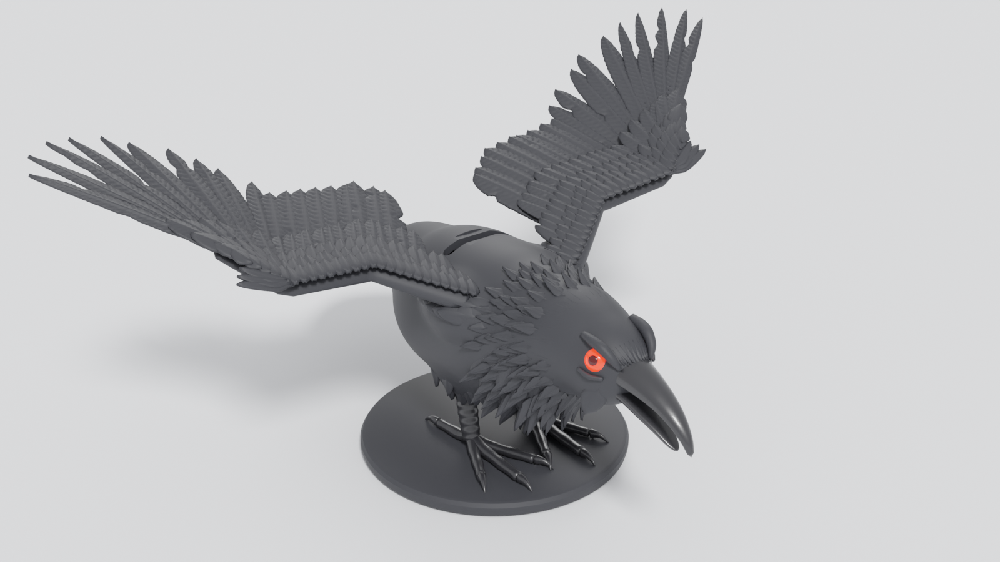
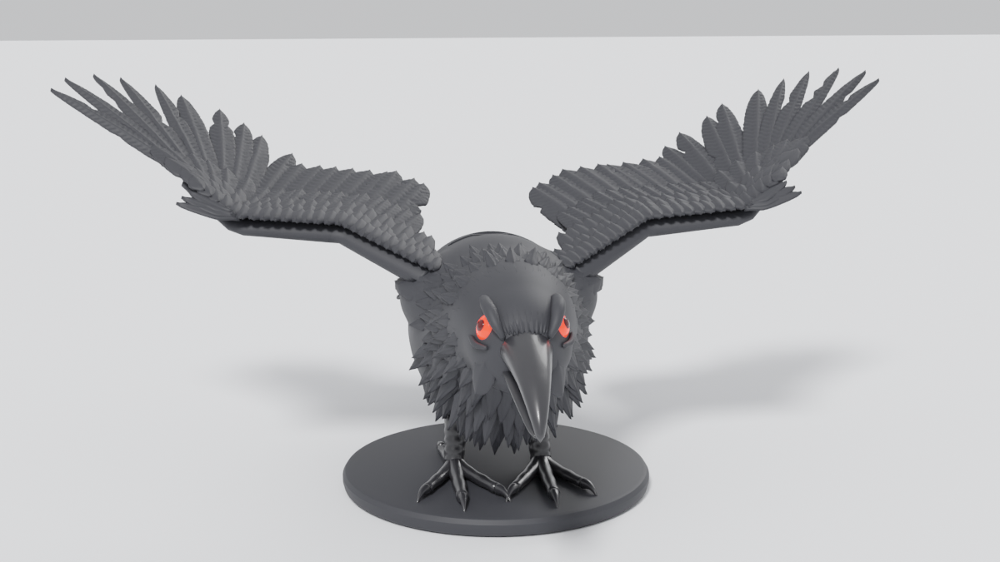
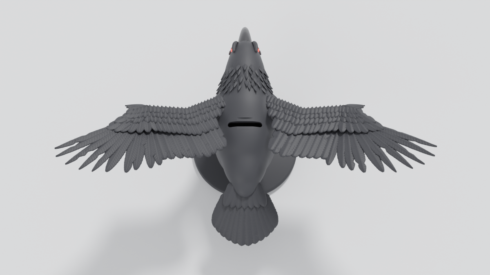
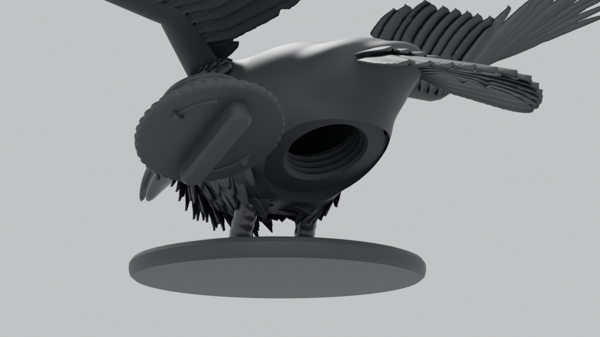
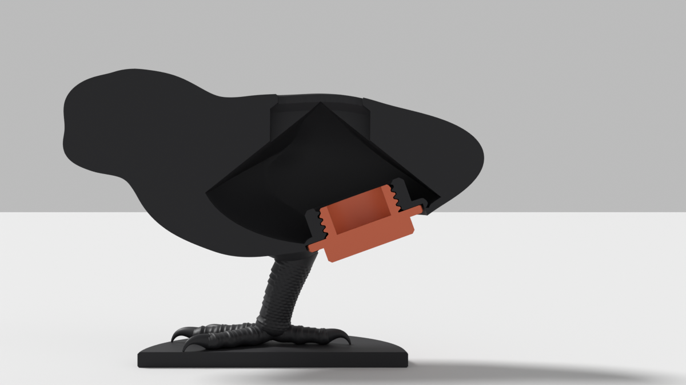

# Krähen-Spardose für Blender

Detaillierte Krähe mit ausgebreiteten Flügeln, roten Augen und geöffnetem Schnabel als Spardose.
Oben auf dem Rücken sitzt der Münzschlitz, unten am Schwanz ein Schraubverschluss zum Leeren.



| Vorne | Oben (Münzschlitz) |
|---|---|
|  |  |
| **Schraubdeckel abgenommen** | **Schnitt: hohler Körper + Gewinde** |
|  |  |

## Dateien

| Datei | Inhalt |
|---|---|
| `kraehe_spardose.blend` | Fertiges Blender-Modell (Einheit mm) mit Materialien, Kamera und Licht |
| `kraehe_spardose.py` | Generator-Skript, erzeugt das Modell neu (Parameter oben im Skript) |
| `kraehe_spardose_stl.zip` | Druckfertige STL-Dateien (mm) |
| `vorschau/` | Gerenderte Vorschaubilder |

## In Blender öffnen

`kraehe_spardose.blend` öffnen (getestet mit Blender 4.5 LTS und 5.2). Die Szene ist auf Millimeter
eingestellt. Mit `Pos1`/`Home` im 3D-Fenster passt die Ansicht auf das Modell, `F12` rendert das
Titelbild (Cycles).

Collections:

- **Koerper**: hohler Körper mit Münzschlitz und Innengewinde
- **Fluegel**: linker und rechter Flügel (jede Feder einzeln modelliert, mit Federästen)
- **Details**: Schnabel, Augen, Pupillen, Halskrause, Brust-, Kopf- und Schenkelfedern, Schwanz, Beine, Sockel
- **Schraubdeckel**: Deckel mit Außengewinde, Rändelrand, Griffsteg und Öffnen-Pfeil
- **Kraehe_Szene**: Kamera, Licht, Boden (nur fürs Rendern)

## Modell neu erzeugen / anpassen

Blender → Arbeitsbereich *Scripting* → *Öffnen* → `kraehe_spardose.py` → *Run Script*.
Ein neuer Lauf ersetzt die Collection `Kraehe_Spardose` (dauert ca. 10 Sekunden).
Oben im Skript lassen sich u. a. einstellen:

| Parameter | Standard | Bedeutung |
|---|---|---|
| `WAND` | 3.0 mm | Wandstärke des Körpers |
| `GEWINDE_RADIUS` | 16.0 mm | Außenradius des Deckelgewindes (Ø 32 mm) |
| `GEWINDE_STEIGUNG` | 3.0 mm | Gewindesteigung |
| `GEWINDE_SPIEL` | 0.4 mm | radiales Spiel zwischen Deckel und Körper |
| `SCHLITZ` | 34 × 5.5 mm | Münzschlitz (passt für alle Euro-Münzen) |
| `DACH_STEIGUNG` | 0.8 | Neigung der Innendecke (siehe Druckhinweise) |
| `SEED` | 7 | Zufallswert für die Federvariation |

Aus der Kommandozeile, inklusive STL-Export:

```bash
blender -b --python kraehe_spardose.py -- --blend kraehe_spardose.blend --stl stl
```

## Technische Daten

- Maße: Spannweite 334 mm, Länge (Schnabel bis Schwanz) 247 mm, Höhe 151 mm, Sockel Ø 117 mm
- Innenvolumen ca. 124 ml (etwa 60–80 gemischte Münzen)
- Öffnung bei abgenommenem Deckel: Ø 30 mm (2-€-Münzen mit Ø 25,75 mm fallen durch)
- Gewinde: eingängiges Rechtsgewinde, 3 mm Steigung, 1,4 mm Tiefe, 0,4 mm radiales und
  ca. 0,2 mm axiales Spiel, Einlauffasen an beiden Enden.
  **Zudrehen: im Uhrzeigersinn, Öffnen: gegen den Uhrzeigersinn** (Pfeil auf dem Deckel).
- Alle Teile sind geschlossen (wasserdicht, 0 offene Kanten). Geprüft: Deckel und Körper
  überschneiden sich nicht, und nichts ragt in den Hohlraum.

## 3D-Druck-Hinweise

STL-Dateien im Zip:

1. `01_Koerper_mit_Sockel.stl`: Körper, Kopf, Federn, Schwanz, Beine und Sockel. Aufrecht auf dem
   Sockel drucken. Die Innendecke ist als Dach mit ca. 39° geformt und druckt ohne Stützen im
   Inneren; außen brauchen Schnabel, Schwanz und Bauch Stützen (Baumstützen empfohlen).
2. `02_Fluegel_links.stl` / `03_Fluegel_rechts.stl`: separat drucken und ankleben. Die Flügel enden
   genau auf der Körperoberfläche und lassen sich daher passgenau ankleben.
3. `04_Schraubdeckel.stl`: liegt schon in Druckausrichtung (Becherrand unten). Unter dem Rand des
   Deckels sind Stützen nötig.
4. `05_Augen_rot.stl`: für Mehrfarbdruck (rot) oder als Teil des Körpers mitdrucken.

Für das Gewinde 0,12–0,16 mm Schichthöhe nutzen. Die Gewindeachse liegt im Körper schräg; das
Spiel ist großzügig gewählt, eventuell einmal mit etwas Kraft durchdrehen. Schließt der Deckel zu
locker oder zu stramm, `GEWINDE_SPIEL` anpassen und neu exportieren.

Wird das ganze Modell im Slicer verkleinert, schrumpft auch die Öffnung. Bis etwa 90 % passen
2-€-Münzen noch hindurch.
