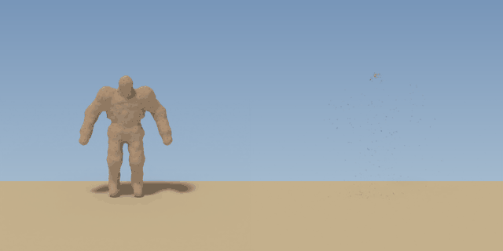

# Sand-Monster-VFX für Roblox (gebaut in Blender)

Nachbau des Greenscreen-Effekts „Sand Monster“: Ein Sand-Golem brüllt, zerfällt von oben nach
unten zu Sand und Staub und hinterlässt einen Sandhaufen. Gebaut wird alles prozedural per
Python-Skript in Blender und für Roblox aufbereitet.



## Inhalt

| Datei | Wofür |
|---|---|
| `blender/sand_monster_vfx.py` | Blender-Skript: baut Golem, Rig, Animation, Partikel-Simulation, rendert alles |
| `output/SandMonsterVFX.blend` | fertige Blender-Szene zum Anschauen / Anpassen |
| `output/SandMonster_Collapse_8x8.png` | Flipbook: Golem brüllt + zerfällt (64 Frames, 1024×1024) |
| `output/SandMonster_Collapse_4x4.png` | dasselbe mit 16 Frames, dafür doppelte Auflösung |
| `output/SandMonster_Rise_8x8.png` | rückwärts: Golem setzt sich aus Sand zusammen |
| `output/SandBurst_8x8.png` | nur Sandexplosion + Haufen (ohne Körper) als Overlay für echte 3D-Modelle |
| `output/SandGrain.png`, `output/SandDust.png` | Texturen für Roblox-ParticleEmitter (weiß, werden per `Color` eingefärbt) |
| `output/SandGolem.fbx` | der Golem als Modell aus 16 Teilen (Kopf, Torso, Arme, Beine …) |
| `output/vfx_meta.json` | Timing und Größen (stehen schon im Luau-Modul) |
| `output/preview.gif`, `output/preview_greenscreen.mp4` | Vorschau (links Collapse, rechts Burst) bzw. Greenscreen-Version wie das Original |
| `roblox/SandMonsterVFX.lua` | ModuleScript: Flipbook abspielen, Modelle zerbröseln, Sandhaufen |
| `roblox/Example.server.lua` | Beispiel: Golem zerfällt, wenn ein Spieler ihn berührt |

## In Roblox einbauen

1. **Bilder hochladen:** In Roblox Studio *View → Asset Manager → Bulk Import*. Dort die PNGs aus
   `output/` auswählen und danach per Rechtsklick auf jedes Bild die Asset-ID kopieren.
2. **Golem importieren (optional):** *File → Import 3D* → `SandGolem.fbx`. Falls die Größe nicht
   passt, bei *File Dimensions* „Meters“ wählen, dann ist er ca. 7 Studs groß. Das Modell
   „SandGolem“ nennen, alle Teile auf `Material = Sand` und eine Sandfarbe stellen
   (z. B. `196, 168, 136`) und `Anchored` aktivieren.
3. **Skripte:**
   - `roblox/SandMonsterVFX.lua` → als **ModuleScript** namens `SandMonsterVFX` in `ReplicatedStorage`
   - Asset-IDs oben im ModuleScript bei `SandMonsterVFX.Assets` eintragen (`"rbxassetid://…"`)
   - `roblox/Example.server.lua` → als **Script** in `ServerScriptService`
4. Spiel starten und gegen den Golem laufen: Er zerbröselt von Kopf bis Fuß, gleichzeitig läuft die
   gerenderte Sandexplosion, und am Ende bleibt ein Sandhaufen liegen.

### Was das Modul kann

```lua
local SandMonsterVFX = require(game.ReplicatedStorage.SandMonsterVFX)

SandMonsterVFX.collapse(model)                     -- alles zusammen (wie im Video)
SandMonsterVFX.collapse(model, { flipbook = false }) -- nur Roblox-Partikel, ohne Blender-Render

SandMonsterVFX.playFlipbook(position, { sheet = "Collapse" })          -- Blender-Golem als Billboard
SandMonsterVFX.playFlipbook(position, { sheet = "Rise", scale = 1.5 }) -- Golem entsteht aus Sand

SandMonsterVFX.disintegrate(npc)                   -- beliebigen NPC/Charakter zerbröseln lassen
SandMonsterVFX.spawnPile(position, { lifetime = 10 })
```

`collapse` und `disintegrate` funktionieren mit jedem Modell, auch mit R15-Charakteren. Die Teile
werden nach Höhe sortiert und zerfallen von oben nach unten. Je mehr Teile ein Modell hat, desto
schöner wirkt das; deshalb ist das FBX in 16 Stücke aufgeteilt.

Ohne eingetragene Grain-/Dust-IDs nimmt das Modul Roblox-Standardtexturen, der Effekt
funktioniert also auch schon vor dem Upload.

### Flipbook von Hand einstellen

Wer die Sheets ohne das Modul benutzt, stellt den `ParticleEmitter` so ein:

| Property | Wert |
|---|---|
| `FlipbookLayout` | `Grid8x8` (bzw. `Grid4x4` für das 4×4-Sheet) |
| `FlipbookMode` | `OneShot` |
| `Lifetime` | `4.267` (64 Frames bei 15 fps) |
| `Rate` | `0`, dann per Skript `emitter:Emit(1)` |
| `Speed` / `Rotation` / `RotSpeed` | `0` |
| `Size` | `14` (≈ 7 Studs großer Golem; das Bild ist 3,9 m = ~14 Studs breit) |
| `LightInfluence` | `0.5` |

Der Boden (die Füße) liegt bei **22,6 %** der Bildhöhe von unten. Das Partikel sitzt mittig auf
seiner Position, darum muss der Emitter `(0.5 - 0.226) × Size` Studs über dem Boden sitzen.

### Tipp: auf dem Client abspielen

Ein Script auf dem Server reicht und funktioniert. Für flüssigere Effekte in großen Spielen ist aber
dieses Muster üblich: Der Server feuert ein `RemoteEvent` mit dem Modell
(`FireAllClients(model)`), ein `LocalScript` ruft dann `SandMonsterVFX.collapse(model, { destroy = false })`
auf, und der Server löscht das Modell nach ca. 5 Sekunden.

## Blender-Teil

Getestet mit Blender 4.5 LTS (geht ab 4.2). Rendert mit Cycles auf der CPU.

```bash
# alles neu bauen + rendern (ca. 20–30 min auf 4 CPU-Kernen)
blender -b -P blender/sand_monster_vfx.py -- --out output --save output/SandMonsterVFX.blend

# schneller Probelauf mit wenigen Partikeln in kleiner Auflösung (ein paar Minuten)
blender -b -P blender/sand_monster_vfx.py -- --out test_output --quick
```

Alternativ in Blender selbst: *Scripting*-Tab → Skript öffnen → *Run Script*. Dann wird nur die
Szene aufgebaut. Mit der Leertaste spielst du die Simulation ab, mit F12 renderst du einen Frame.
Oder du öffnest gleich `output/SandMonsterVFX.blend`.

So ist der Effekt aufgebaut:

- **Golem:** Metaballs (Kapseln und Ellipsoide entlang eines Skeletts), in ein Mesh umgewandelt und
  mit „Clouds“-Displacement klumpig gemacht. Material: poröser Sand (Voronoi-Poren plus Rauschen).
- **Rig und Animation:** 18 Knochen mit automatisch berechneten Gewichten. Der Golem reißt die
  Arme hoch, wackelt und sackt beim Zerfallen in sich zusammen.
- **Zerfall:** Für jeden Vertex wird die Höhe zu Beginn des Zerfalls gespeichert (`dissolve_z`,
  plus Rauschen). Der Shader blendet alles oberhalb einer sinkenden „Front“ aus, und an der
  Schnittkante sieht man massiven Sand statt eines hohlen Körpers.
- **Partikel:** In 8 Höhenbändern startet jeweils genau dann ein System, wenn die Front das Band
  erreicht: schwere Körner und Brocken (bleiben am Boden liegen), feiner Staub (verweht durch
  Turbulenz und Aufwind und blendet über `Particle Info` aus) sowie Sand, der schon vorher rieselt.
- **Sandhaufen:** ein verformtes Gitter, das wächst und einen ausgefransten Rand hat.
- **Ausgabe:** transparenter Hintergrund, Schatten über einen Shadow Catcher, orthografische
  Kamera. Die Frames werden herunterskaliert (mit vormultipliziertem Alpha) und zu
  1024×1024-Sheets zusammengesetzt. Unsichtbare Pixel werden sandfarben gefüllt, damit Roblox beim
  Filtern keine dunklen Ränder erzeugt.

Die wichtigsten Stellschrauben stehen oben im Skript unter **Einstellungen**: Timing
(`COLLAPSE_START`/`COLLAPSE_END`), Partikelmengen, Farben (`SAND`), Auflösung/Samples und die
Pose-Keyframes (`POSES`). Wenn du Timing oder Kamera änderst, trag die neuen Werte aus
`output/vfx_meta.json` in `SandMonsterVFX.Meta` ein.
