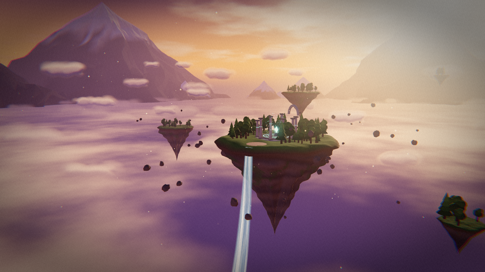

# Der Himmelsdrache

Fan-Art-Szene: Link reitet auf einem Drachen über die Himmelsinseln. Das 3D-Modell
erzeugt [Meshy](https://www.meshy.ai) per Text-to-3D, die Szene drumherum ist
three.js (r160) in einer einzigen `index.html`.



## Modell erzeugen

```bash
export MESHY_API_KEY=msy_...        # Schlüssel nur als Umgebungsvariable, nie committen
python3 generate_meshy.py           # Preview-Mesh, dann Refine mit PBR-Texturen
./optimize.sh                       # WebP-Texturen + quantisierte Vertices -> assets/dragon.glb
```

`generate_meshy.py --resume` setzt nach einem Abbruch mit den Task-IDs aus
`assets/meshy_tasks.json` fort, `--seed N` liefert eine andere Variante.

## Szene

- Goldene Stunde mit Sonnen-Nebel, Zirruswolken, Sternen und einem Wolkenmeer
- Schwebende Inseln mit Bäumen, Wasserfall, Felsbrocken und Ruinen mit leuchtendem Runenkreis
- Flügelschlag, Schwanz- und Halsbewegung per Vertex-Shader direkt auf dem Meshy-Mesh
  (ohne Rigging), Schatten über ein passendes Depth-Material
- Feueratem mit Flammen-, Rauch- und Funkenpartikeln, Fassrolle und Brüllen mit Schockwelle
- Kameraregie mit sieben Einstellungen, freie Kamera per Ziehen
- Bloom, Vignette, Farbkorrektur, Filmkorn; Wind-, Flügel-, Feuer- und Brüllgeräusche per Web Audio

Tasten: `F` Feuer · `R` Fassrolle · `B` Brüllen · `C` Kamera · `O` frei/Kino · `M` Ton

### Anpassen an das Modell

Die Szene erwartet den Kopf in +Z und die Flügel entlang X. Für Feintuning gibt es
URL-Parameter (lokal): `yaw`, `flip`, `wroot`, `welbow`, `wy`, `tail`, `neck`, `mouth=x,y,z`
und `debug` (färbt die Flügel-, Schwanz- und Halsgewichte ein).

Lokal starten: `python3 -m http.server` in diesem Ordner, dann `http://localhost:8000`.
